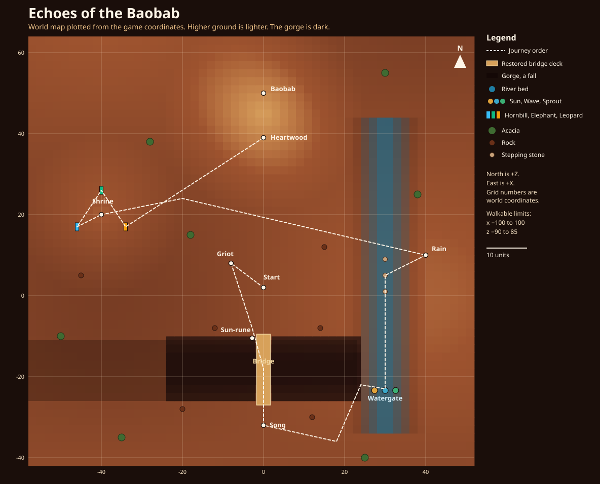
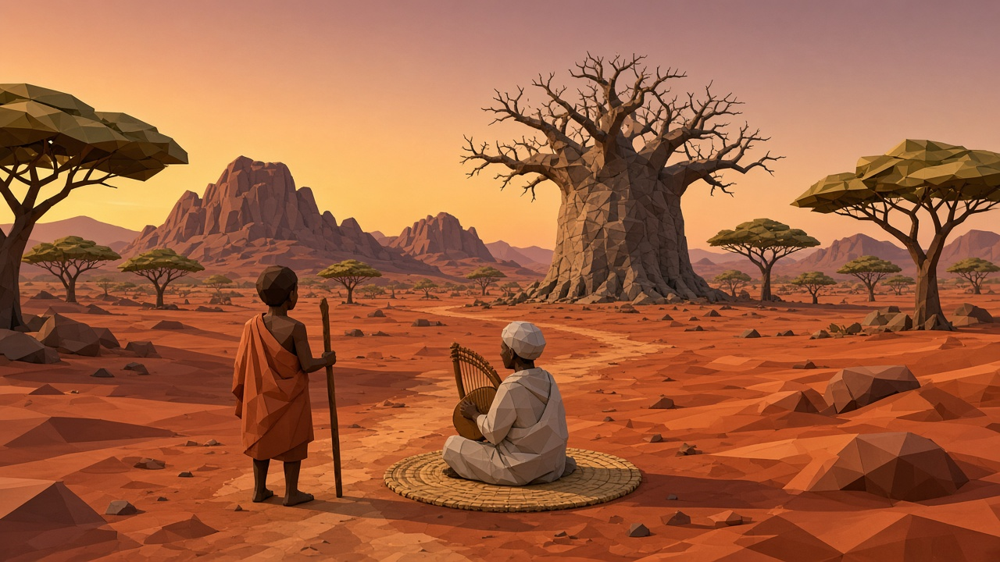
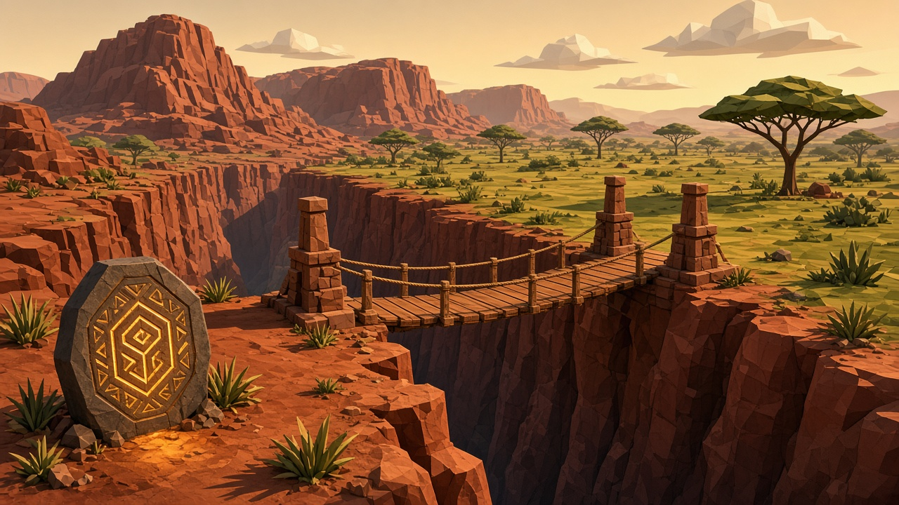
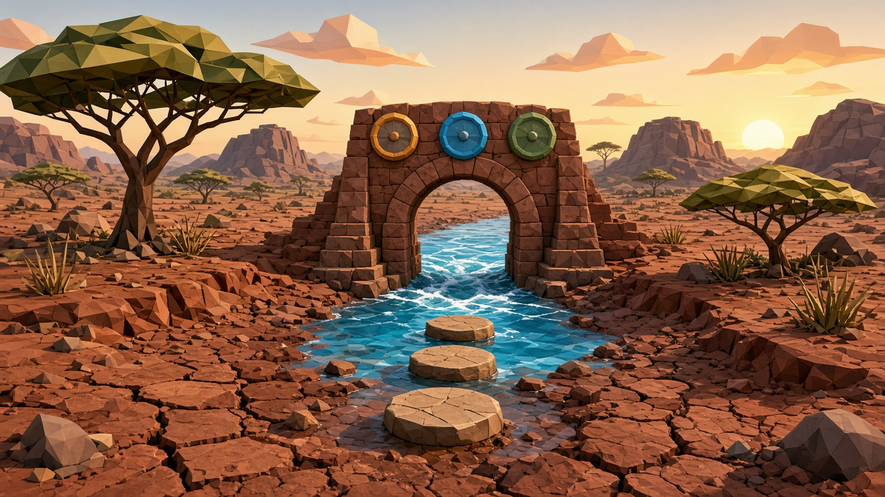
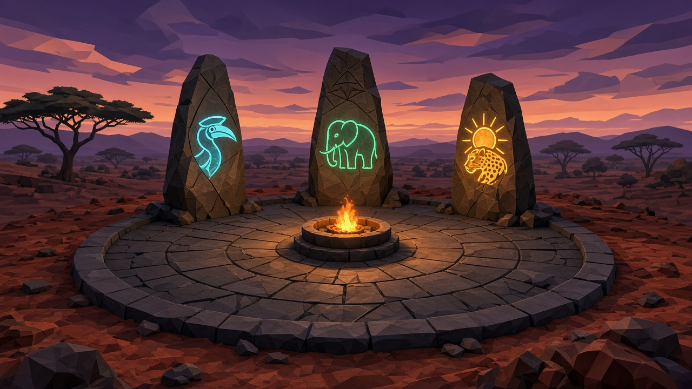
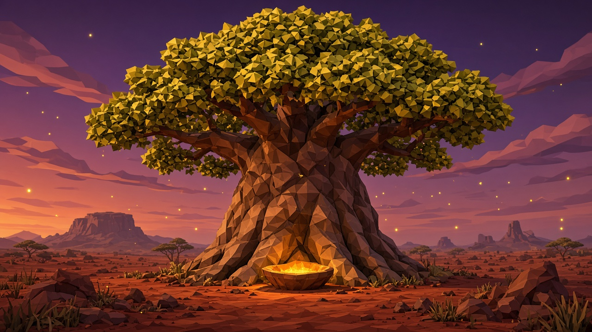

# Echoes of the Baobab

> **An African-inspired 3D mystical exploration puzzle game where players reveal the past using the REMEMBER mechanic to restore ancient lands and the Grandfather of Trees.**

---

## Play

The game runs in a desktop or mobile browser. Keyboard and mouse, or the on-screen touch controls. There is no gamepad support and no native console build.

```bash
npm install
npm run dev
```

Open the local URL Vite prints. For the production build:

```bash
npm run build
npm run preview
```

---

## World map

North is **+Z** and east is **+X**. The grid numbers are the same coordinates the game uses. Lighter ground is higher: the shrine mound and the baobab plateau. The dark band is the gorge. The blue channel is the river bed. The dashed line is the journey order, from the start through the three puzzles to the heartwood.



You can walk from about x −100 to 100 and z −90 to 85. The gorge between z −26 and z −11 is a fall everywhere except the restored bridge deck, near x 0, and the river pocket from x 23 to 40.

---

## Scenes

### Opening savanna



The journey starts on the red clay. Baba Olatunji sits near the path. The Great Baobab waits dormant in the distance.

### The Forgotten Bridge



REMEMBER shows the lost span. The sun-rune restores the deck, and the gorge can be crossed only there.

### The Forgotten River



Sun, Wave, and Sprout stand west to east. One alignment releases the river. The stepping stones lead on toward the rain memory.

### The Memory Shrine



Attune Hornbill, then Elephant, then Sun Leopard. REMEMBER brightens their marks. A wrong totem clears the sequence.

### The Baobab



After the three puzzles are solved and Song, Rain, and Community are gathered, the heartwood blooms and the win screen appears.

---

## 📖 Overview

**Echoes of the Baobab** is an African-inspired 3D mystical exploration and puzzle game. Players assume the mantle of a young **Memory Keeper**, journeying across a red-clay savanna where ancient songs have faded into wind, lifeblood rivers have dried into cracked canyons, and the sacred Great Baobab sits dormant in ruin.

By channeling the ancient ability to **REMEMBER**, players temporarily unveil the dreamlike past version of the world—discovering intact architectural spans, flowing waters, hidden alignments, and glowing ancestral glyphs to solve environmental puzzles in the present.

---

## 🏛️ Architectural Blueprints

### System Architecture Blueprint

```
+-----------------------------------------------------------------------------------------+
|                                    REACT APPLICATION ROOT                               |
|                                       (src/App.tsx)                                     |
+-----------------------------------------------------------------------------------------+
       |                                       |                                    |
       v                                       v                                    v
+------------------+                 +--------------------+               +-------------------+
|    STATE LAYER   |                 |    2D UI OVERLAY   |               |   3D WEBGL ENGINE |
| - gameView       |                 | (Tailwind CSS v4)  |               |  (Three.js Scene) |
| - memories (4)   |<--------------->| - StartScreen      |<------------->| - WorldBuilder    |
| - difficulty     |                 | - GameHUD (Ring)   |               | - PlayerController|
| - puzzleState    |                 | - MemoriesModal    |               | - GameTimer       |
| - timeElapsed    |                 | - SettingsModal    |               | - SoundEngine     |
+------------------+                 | - Loss / WinScreen |               +-------------------+
                                     +--------------------+
```

---

### 3D Game Loop & Rendering Pipeline

```
           +------------------------------------------------------+
           |                   requestAnimationFrame              |
           +------------------------------------------------------+
                                      |
                                      v
           +------------------------------------------------------+
           |         GameTimer.getDelta() (performance.now)       |
           +------------------------------------------------------+
                                      |
                                      v
          +--------------------------------------------------------+
          |                  REMEMBER Ability Tick                 |
          | - If active: countdown timer, update radial HUD        |
          | - If expired: deactivate, trigger cooldown & audio sfx |
          +--------------------------------------------------------+
                                      |
                                      v
          +--------------------------------------------------------+
          |             PlayerController Physics & Orbit           |
          | - Process keys (WASD / D-Pad / Shift Run)              |
          | - Spherical camera follow & yaw/pitch orbit            |
          | - Terrain elevation height sampling                    |
          | - Gorge fall detection -> Trigger Checkpoint / Loss    |
          | - Interactive proximity detection                      |
          +--------------------------------------------------------+
                                      |
                                      v
          +--------------------------------------------------------+
          |               WorldBuilder Animations                  |
          | - Memory Fragment orbital rotation & hover bobbing     |
          | - Firefly drift buffer updates                         |
          | - REMEMBER spirit particle updraft simulation          |
          | - Flowing river water displacement                     |
          | - InstancedMesh Baobab canopy bloom scaling            |
          +--------------------------------------------------------+
                                      |
                                      v
          +--------------------------------------------------------+
          |             WebGLRenderer.render(scene, camera)        |
          | - ACESFilmicToneMapping & PCFSoftShadowMap             |
          +--------------------------------------------------------+
```

---

### Procedural Web Audio Signal Blueprint

```
+------------------+        +-------------------+
|  Kalimba Synth   |------->|                   |
| (D-Pentatonic)   |        |                   |
+------------------+        |                   |
+------------------+        |   Music Gain      |
|  Udu / Log Drum  |------->|   (Dynamic layer  |
|  (85Hz - 130Hz)  |        |    per Memory)    |
+------------------+        |                   |
+------------------+        |                   |
|   Kora Plucks    |------->|                   |
| (Calabash filter)|        +-------------------+
+------------------+                  |
                                      v
+------------------+        +-------------------+        +--------------------+
| Ambient Savanna  |------->|   Master Gain     |------->| AudioDestination   |
| (Pink Wind/Crick)|        | (Mute & Volume)   |        | (Speaker / Output) |
+------------------+        +-------------------+        +--------------------+
                                      ^
+------------------+                  |
|  SFX Generators  |------------------+
| - REMEMBER Gong  |
| - Water Rush     |
| - Shrine Chimes  |
| - Memory Fanfare |
+------------------+
```

---

## 🎮 How to Play

### Objectives
1. **Explore the Savanna**: Navigate the red earth, kopjes, and acacia groves.
2. **Consult the Griot**: Speak with *Baba Olatunji*, the elder Storyteller seated near the starting path with his kora harp.
3. **Use REMEMBER [R]**: Temporarily peer into the past to uncover hidden clues, bridges, and alignments.
4. **Solve the Three Sacred Puzzles**:
   - **The Forgotten Bridge**: Stand at the gorge and REMEMBER. The lost deck appears. Interact with the sun-rune only after you have seen it. The gorge can be crossed only on the restored deck.
   - **The Forgotten River**: REMEMBER at the watergate. Cyan marks show where each wheel's pale pip should rest: Sun, Wave, and Sprout, west to east. Turn them in the present to match. One alignment releases the river.
   - **The Memory Shrine**: REMEMBER on the rise. Beads above the totems show the order: Hornbill, then Elephant, then Sun Leopard. A wrong totem clears the sequence. A completed shrine stays solved.
5. **Awaken the Great Baobab**: Solve all three puzzles, and gather **Memory of Song**, **Memory of Rain**, and **Memory of Community**. The heartwood stays asleep until both are true. **Memory of the Baobab** is granted as the canopy blooms, and the win screen follows.

---

## 🕹️ Controls Reference

### Desktop (Keyboard & Mouse)
| Key / Input | Action |
| :--- | :--- |
| **W, A, S, D** / **Arrow Keys** | Walk. Releasing the key stops that direction. |
| **Space** | Jump, including onto ledges and the stepping stones. |
| **Shift** (Hold) | Sprint while held. |
| **Mouse drag** | Orbit the third-person camera. Left or right button. |
| **Mouse scroll wheel** | Zoom in or out. |
| **E** | Interact, turn a wheel, or speak. Once per press. |
| **R** | Toggle **REMEMBER**. Once per press. |

### Mobile & Touch Screens

Touch controls appear on a coarse pointer (a phone or tablet, portrait or landscape). A narrow desktop window does not show them.

- **D-pad**: ▲ ◀ ▼ ▶. Releasing one direction stops that direction.
- **Touch drag** on the world: orbit the camera. This can happen while another finger holds movement or an action.
- **JUMP**, **RUN** (toggle), **INTERACT**, and **REMEMBER**. Interact and REMEMBER fire once per tap.

---

## ⚖️ Difficulty Configurations

Difficulty changes how long REMEMBER lasts and how long you wait before using it again. Kidogo also shows a faint wisp toward the next step.

| Difficulty | Subtitle | REMEMBER Duration | Cooldown |
| :--- | :--- | :--- | :--- |
| **KIDOGO** | Gentle / Easy | **14.0s** | 2.0s |
| **SAFARI** | Balanced / Normal | **8.0s** | 3.0s |
| **ANCESTOR** | Sacred / Hard | **4.5s** | 4.0s |

---

## 🛠️ Tech Stack & Technologies Used

- **Framework**: [React 19](https://react.dev/) + [TypeScript](https://www.typescriptlang.org/)
- **Build Tool**: [Vite 8](https://vite.dev/)
- **3D Graphics Engine**: [Three.js](https://threejs.org/) (custom procedural low-poly savanna terrain, animated instanced leaves, particle systems, dynamic shadows, and ACESFilmic tone mapping)
- **Timing Engine**: Custom `GameTimer` utilizing high-precision `performance.now()` (zero deprecation warnings, sub-millisecond delta accuracy)
- **Styling & Animations**: [Tailwind CSS v4](https://tailwindcss.com/) with custom keyframe animations:
  - `@keyframes remember-ring-grow`: Multi-layer pulsating cyan/amber edge box-shadows
  - `@keyframes ring-expand-pulse`: Breathing inner concentric aura ring
  - `@keyframes remember-shimmer-sweep`: Inward-filtering radial twilight gradient
- **Icons**: [Lucide React](https://lucide.dev/)
- **Audio Synthesis**: Native HTML5 Web Audio API (procedural African acoustic instruments, ambient wind filters, and dynamic multi-track progression)
- **Celebration Effects**: [Canvas Confetti](https://www.npmjs.com/package/canvas-confetti)
- **Typography**: Google Fonts (*Cinzel* & *Plus Jakarta Sans*)

---

## 📂 Project Architecture

```
├── index.html                   # HTML entry point with fonts & metadata
├── metadata.json                # AI Studio application metadata
├── package.json                 # Project dependencies & scripts
├── README.md                    # Comprehensive documentation & blueprints
├── docs/
│   └── images/                  # Scene illustrations and the world map
├── src/
│   ├── main.tsx                 # React DOM mount point
│   ├── App.tsx                  # Root orchestration & game view state
│   ├── index.css                # Tailwind CSS imports & custom glowing ring keyframes
│   ├── types/
│   │   └── game.ts              # Game state, puzzle types, memories, difficulty configs
│   ├── audio/
│   │   └── SoundEngine.ts       # Procedural Web Audio API African acoustic synthesizer
│   ├── game/
│   │   ├── WorldBuilder.ts      # Three.js stylized terrain, Baobab tree, Kopjes, puzzles & particles
│   │   ├── PlayerController.ts  # 3rd-person character mesh, walking animations & orbital camera
│   │   └── GameEngine.ts        # Scene loop, collision, REMEMBER timing & puzzle handlers
│   └── components/
│       ├── StartScreen.tsx      # Cinematic landing with difficulty selector
│       ├── GameHUD.tsx          # Real-time HUD, glowing edge ring overlay, touch controls
│       ├── MemoriesModal.tsx    # Journal modal for unlocked ancestral lore
│       ├── SettingsModal.tsx    # Volume, difficulty & controls reference
│       ├── DialogueModal.tsx    # Storyteller Griot dialog & African proverbs
│       ├── LossScreen.tsx       # Checkpoint respawn screen
│       ├── WinScreen.tsx        # Victory screen with statistics & confetti
│       └── RestorationCinematic.tsx # Unused by the win path; the bloom plays in the world
```

---

## 📜 Philosophy & Lore

> *“A story does not die because the teller is silent; it dies only when the listener forgets.”*  
> — Baba Olatunji, Griot of the Savanna
